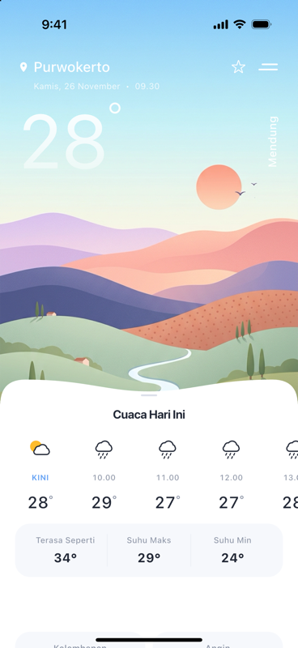
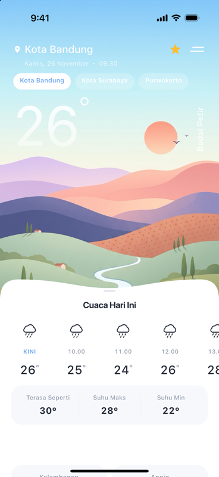
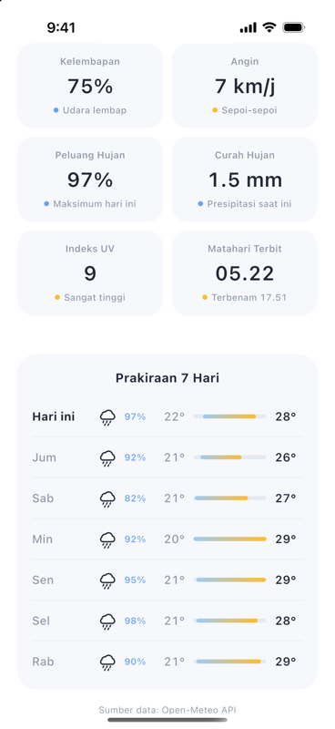
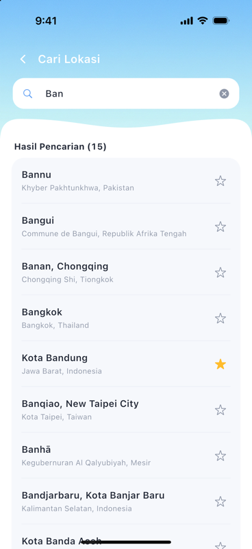
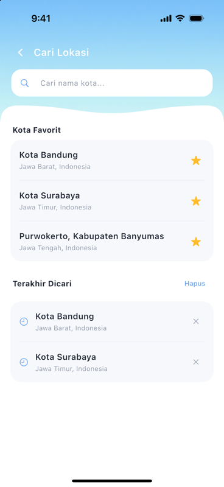
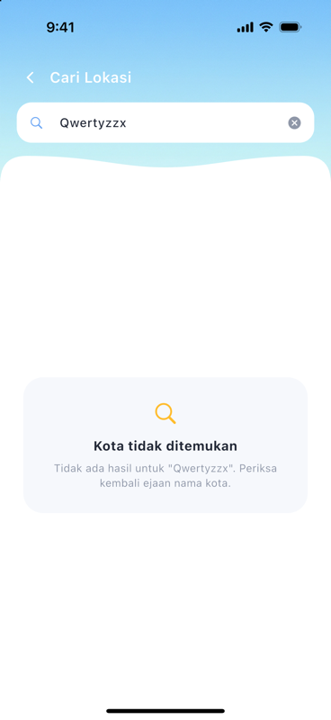

# Responsi Pemrograman Mobile

Nama : Althaf Nadhif Saputra

NIM : H1D024108

Shift awal : E

Shift akhir : E

---

## Deskripsi Aplikasi

Aplikasi ini merupakan aplikasi informasi cuaca berbasis Flutter dan bahasa pemrograman Dart yang dibuat untuk memenuhi tugas Responsi Pemrograman Mobile. Data cuaca dan pencarian lokasi diambil secara langsung dari layanan Open-Meteo API menggunakan metode HTTP GET.

Aplikasi memiliki dua halaman utama, yaitu halaman utama cuaca (Home Screen) dan halaman pencarian kota (Search Screen). Pengguna dapat melihat suhu saat ini, kondisi cuaca, kelembapan udara, kecepatan angin, peluang hujan, curah hujan, indeks UV, waktu matahari terbit dan terbenam, prakiraan cuaca 24 jam, serta prakiraan cuaca 7 hari ke depan. Selain itu, pengguna dapat mencari kota di seluruh dunia, menyimpan lokasi sebagai kota favorit, dan melihat kembali riwayat pencarian yang tersimpan di penyimpanan lokal perangkat.

---

## Tampilan Aplikasi

### 1. Home / Weather Screen

<p align="center">
  
  
  
</p>

Halaman utama menampilkan nama kota yang sedang dipilih beserta tanggal hari ini, kartu cuaca utama (kondisi cuaca terkini, suhu saat ini, suhu yang dirasakan, serta suhu maksimum dan minimum harian), daftar chip kota favorit untuk berpindah lokasi dengan cepat, prakiraan cuaca per jam selama 24 jam, rincian informasi cuaca tambahan, serta daftar prakiraan cuaca untuk 7 hari ke depan.

### 2. Search / Location Screen

<p align="center">
  
  
  
</p>

Halaman pencarian menyediakan kolom input untuk mencari kota berdasarkan nama lokasi. Saat kolom pencarian belum diisi, halaman ini menampilkan daftar kota favorit dan riwayat pencarian yang sudah tersimpan di memori lokal. Ketika pengguna mengetik nama kota, aplikasi mengirimkan permintaan ke Geocoding API dan menampilkan daftar hasil pencarian beserta tombol bintang untuk menyimpan lokasi ke daftar favorit. Halaman ini juga menangani kondisi ketika data sedang dimuat (loading), lokasi tidak ditemukan (data kosong), maupun ketika terjadi gangguan jaringan (error).

---

## Struktur Aplikasi

Kode program aplikasi berada di dalam folder `lib` yang dibagi ke dalam beberapa bagian sesuai fungsinya:

- `lib/main.dart` : Titik masuk utama aplikasi untuk inisialisasi format tanggal Bahasa Indonesia, konfigurasi Provider, dan pengaturan tema aplikasi.
- `lib/core/theme.dart` : Pengaturan tema Material Design, warna, dan tipografi aplikasi agar tampilan konsisten di seluruh halaman.
- `lib/core/weather_condition.dart` : Pemetaan kode cuaca WMO dari Open-Meteo menjadi nama kondisi cuaca, ikon, dan warna.
- `lib/core/formatters.dart` : Fungsi bantu untuk memformat tampilan suhu, jam, hari, tanggal, dan kode bendera negara.
- `lib/models/location.dart` : Model data lokasi hasil pencarian dari Geocoding API beserta konversi JSON.
- `lib/models/weather.dart` : Model data cuaca terkini, prakiraan per jam, dan prakiraan harian beserta konversi JSON.
- `lib/services/weather_api_service.dart` : Layanan HTTP Request menggunakan metode GET untuk mengambil data dari Open-Meteo API.
- `lib/services/storage_service.dart` : Layanan penyimpanan lokal menggunakan SharedPreferences untuk menyimpan daftar kota favorit, riwayat pencarian, dan kota terakhir yang dibuka.
- `lib/viewmodels/view_state.dart` : Definisi status state tampilan (initial, loading, success, empty, error).
- `lib/viewmodels/weather_viewmodel.dart` : Pengelolaan state data cuaca pada halaman utama.
- `lib/viewmodels/search_viewmodel.dart` : Pengelolaan state pencarian lokasi dan riwayat pencarian pada halaman pencarian.
- `lib/viewmodels/favorite_viewmodel.dart` : Pengelolaan state daftar kota favorit.
- `lib/views/home_screen.dart` : Tampilan halaman utama cuaca.
- `lib/views/search_screen.dart` : Tampilan halaman pencarian lokasi.
- `lib/views/widgets/` : Kumpulan komponen tampilan seperti kartu cuaca utama, prakiraan per jam, prakiraan harian, kotak informasi tambahan, baris daftar lokasi, dan pesan kondisi loading atau error.

---

## Penerapan Arsitektur MVVM

Aplikasi ini dibangun menggunakan pola arsitektur Model-View-ViewModel (MVVM) dengan paket `provider` (`ChangeNotifier`) untuk memisahkan logika data dan tampilan antarmuka:

1. **Model** (`lib/models/` dan `lib/services/`)
   Bagian Model bertanggung jawab terhadap struktur data dan sumber data. Class `Location` dan `WeatherData` bertugas mengubah respons JSON dari API menjadi objek Dart melalui fungsi `fromJson` dan `toJson`. Pengambilan data dari internet ditangani oleh `WeatherApiService`, sedangkan pembacaan serta penyimpanan data lokal ke `SharedPreferences` ditangani oleh `StorageService`.

2. **ViewModel** (`lib/viewmodels/`)
   Bagian ViewModel merupakan penghubung antara Model dan View yang dibuat dengan menurunkan class `ChangeNotifier`.
   - `WeatherViewModel` mengelola lokasi yang sedang aktif dan mengambil data cuaca dari `WeatherApiService`. Saat proses pengambilan data berlangsung, status state diubah menjadi `loading`, kemudian diperbarui menjadi `success`, `empty`, atau `error` sesuai hasil respons API, lalu memanggil `notifyListeners()` agar tampilan diperbarui.
   - `SearchViewModel` mengelola kata kunci pencarian kota dengan jeda waktu (debounce) sebelum memanggil Geocoding API, serta mengelola penyimpanan riwayat pencarian ke `StorageService`.
   - `FavoriteViewModel` mengelola penambahan dan penghapusan kota favorit agar selalu sinkron dengan data di `SharedPreferences`.

3. **View** (`lib/views/`)
   Bagian View hanya bertugas menampilkan antarmuka berdasarkan state yang ada di ViewModel menggunakan `context.watch` dan meneruskan interaksi pengguna ke ViewModel menggunakan `context.read`. Sebagian besar komponen dibangun menggunakan `StatelessWidget` karena perubahan data dikelola oleh Provider, sedangkan `SearchScreen` menggunakan `StatefulWidget` untuk mengelola siklus hidup `TextEditingController` pada kolom input pencarian.

---

## Implementasi API

Aplikasi menggunakan dua endpoint resmi dari Open-Meteo dengan metode HTTP GET melalui paket `http`:

1. **Geocoding API (Pencarian Kota)**
   - Endpoint: `https://geocoding-api.open-meteo.com/v1/search`
   - Parameter yang digunakan: `name` (nama kota yang dicari), `count=15`, `language=id`, dan `format=json`.
   - Respons JSON pada bagian `results` diolah menjadi daftar objek `Location` yang berisi nama kota, provinsi, negara, koordinat `latitude`, dan `longitude`.

2. **Weather Forecast API (Data Cuaca)**
   - Endpoint: `https://api.open-meteo.com/v1/forecast`
   - Parameter yang digunakan:
     - `latitude` dan `longitude` sesuai koordinat lokasi yang dipilih.
     - `current`: `temperature_2m`, `relative_humidity_2m`, `apparent_temperature`, `precipitation`, `weather_code`, `wind_speed_10m`, `is_day`.
     - `hourly`: `temperature_2m`, `weather_code`, `precipitation_probability`.
     - `daily`: `weather_code`, `temperature_2m_max`, `temperature_2m_min`, `precipitation_probability_max`, `sunrise`, `sunset`, `uv_index_max`.
     - `timezone`: `auto`.
   - Respons JSON diolah oleh `WeatherData.fromJson` menjadi objek cuaca terkini, daftar prakiraan 24 jam, dan daftar prakiraan 7 hari. Apabila permintaan gagal karena tidak ada koneksi internet, waktu tunggu habis, atau status respons tidak berhasil, service akan melempar `ApiException` yang ditangkap oleh ViewModel untuk menampilkan pesan error beserta tombol coba lagi pada layar.

---

## Cara Menjalankan Aplikasi

1. Pastikan Flutter SDK sudah terpasang pada perangkat.
2. Masuk ke direktori proyek lalu unduh seluruh dependensi dengan perintah:
   ```bash
   flutter pub get
   ```
3. Jalankan aplikasi pada emulator, simulator, atau perangkat fisik dengan perintah:
   ```bash
   flutter run
   ```
4. Untuk menjalankan pengujian unit pada model dan service API, gunakan perintah:
   ```bash
   flutter test
   ```
